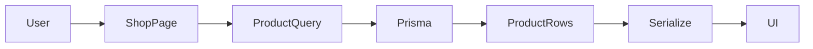
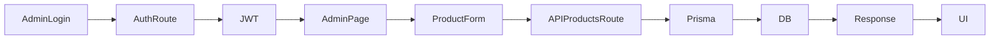
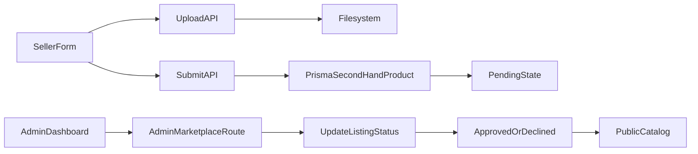

# MkhSounds Living System Specification

This document describes the application as it currently exists in the repository. It is intentionally grounded in source code, configuration, database schema, route handlers, and component structure rather than product intent or future roadmaps.

## 1. Project Overview

MkhSounds is a dark-themed storefront for car audio equipment and accessories built with Next.js. The application combines a public storefront with an administrative catalogue management interface and a second-hand marketplace submission flow.

### What the application does

- Presents featured products, categories, specials, and product detail pages for audio equipment.
- Enables browsing and searching the product catalogue by keyword, category, and price range.
- Supports a local cart that persists in the browser.
- Provides an admin dashboard for creating, editing, and deleting products and categories.
- Allows seller submissions for second-hand audio gear with admin moderation.
- Exposes an AI assistant chat endpoint that calls the OpenAI chat completions API.

### Purpose of the application

The application is a catalogue and sales support system for MkhSounds, focused on showcasing audio products and enabling an operational admin workflow for inventory management.

### Major features

- Public storefront homepage with featured items and category cards
- Product listing with filtering and fuzzy search
- Special offers and product detail pages
- Cart with quantity updates and local persistence
- Admin authentication and protected admin routes
- Product and category CRUD tooling
- Marketplace seller submission and admin approval workflow
- AI chat widget for storefront support
- Image upload handling to the local filesystem or configured upload directory

### Intended users

- Shoppers looking for car audio equipment and accessories
- Store administrators managing inventory and categories
- Sellers submitting used gear for review
- Support staff or customers using the AI assistant widget

### Major business workflows

1. Customer browses the homepage, shop, categories, or specials.
2. Customer searches, filters, and opens a product detail page.
3. Customer adds products to a local cart and reviews line items.
4. Admin signs in to the dashboard, manages products/categories, and can review marketplace submissions.
5. Seller submits a second-hand listing with photos and seller details.
6. Admin approves or declines listing and the catalog reflects approved items only.

---

## 2. Technology Stack

### Core platform

- Next.js: 16.2.4
- React: 19.2.4
- React DOM: 19.2.4
- TypeScript: 5.x
- Node.js runtime: 20 in Dockerfile and application development workflow

### Styling and UI

- Tailwind CSS: 4.x
- Global styling exists in `src/app/globals.css`
- No dedicated UI kit or component library beyond Next.js and custom CSS/Tailwind usage was detected

### Data and persistence

- Prisma ORM: 5.22.0
- Database engine: SQLite via `datasource db { provider = "sqlite" }`
- Prisma client generated for SQLite and Alpine MUSL targets
- No PostgreSQL configuration is present in the active schema or runtime config

### Authentication and security

- JWT signing/verification: `jose` 6.2.2
- Password hashing: `bcryptjs` 3.0.3
- Cookie-based admin sessions using `admin_token`

### External integrations

- OpenAI chat completions API: `fetch` to `https://api.openai.com/v1/chat/completions`
- Environment variables include `OPENAI_API_KEY` and `OPENAI_MODEL`
- No payment provider integration (Stripe, PayFast, etc.) is present in the codebase
- No email service integration was found in the application logic

### Storage and deployment

- Local filesystem uploads via `UPLOAD_DIR`
- Docker deployment is configured via `Dockerfile` and `entrypoint.sh`
- Standalone Next.js build output (`output: "standalone"`) is configured

### Build and tooling

- Package manager: Yarn is defined in `packageManager` (`yarn@1.22.22`), although the repository also contains `package-lock.json`
- Build: `next build`
- Lint: `eslint`
- Migrations: `prisma migrate dev`
- Seed: `tsx prisma/seed.ts`
- Favicon generation script: `scripts/generate-favicons.mjs`

### State management and validation

- Browser state management: React context (`CartProvider`) with `localStorage`
- Client-side validation: custom logic in form handlers and API route checks
- No dedicated validation library such as Zod or Yup was found

---

## 3. Application Architecture

### Next.js App Router structure

The project uses the Next.js App Router in `src/app`. Route groups such as `(site)` and `(dashboard)` keep storefront and admin UI separated, while route handlers under `src/app/api` implement backend functionality.

### Server Components

Server components are used for asynchronous data fetching in public pages and admin list pages. Examples include the home page, shop page, category pages, product detail page, and admin dashboard pages. These pages fetch data directly with Prisma from the server and render HTML.

### Client Components

Client components are used where interactivity is required: cart, search, admin forms, upload fields, chat widget, and admin navigation. They use `useState`, `useEffect`, and `fetch` calls to talk to API routes.

### Server Actions

No server actions were detected. Admin mutation logic is performed through fetch-based client components calling route handlers under `src/app/api`.

### API routes

The app exposes a set of route handlers under `src/app/api` for:

- authentication (`/api/auth/login`, `/api/auth/logout`, `/api/auth/me`, `/api/auth/reset-password`)
- catalogue management (`/api/products`, `/api/products/[slug]`, `/api/categories`, `/api/categories/[id]`)
- upload operations (`/api/uploads`, `/api/admin/upload`)
- public search (`/api/search`)
- marketplace submission (`/api/marketplace/submit`)
- admin approval (`/api/admin/marketplace`)
- AI chat (`/api/chat`)

### Middleware

No `middleware.ts` file or route middleware was found in the repository. Access control is implemented manually by checking the admin JWT cookie in helper functions rather than route middleware.

### Database layer

The database layer is centralized around `src/lib/prisma.ts`, which exports a singleton Prisma client. CRUD operations use Prisma queries directly in page loaders and route handlers.

### Authentication

Authentication is implemented through a JWT stored in an HTTP-only cookie named `admin_token`. The token is signed using `jose` and validated with `verifyAdminToken`. Protected admin API routes call `requireAdminApi()`; protected pages call `requireAdminPage()`.

### External services

- OpenAI for AI assistant responses
- Local filesystem storage for uploaded images
- No production cloud object store or email service was detected

### Data flow

Public storefront flow:

- User request hits a server component page
- Prisma fetches product/category records
- Data is serialized for display
- UI renders product cards and detail views

Admin flow:

- Admin signs in via `/api/auth/login`
- JWT cookie is set on the browser
- Protected admin pages and API routes validate cookie
- Form requests send JSON to API routes
- Prisma creates/updates/deletes records

Marketplace workflow:

- Seller submits listing form
- Client uploads images to `/api/uploads`
- Payload is posted to `/api/marketplace/submit`
- Prisma inserts a `SecondHandProduct` row with `PENDING` status
- Admin reviews in `/admin/marketplace`
- Approved rows become visible to public filters and product queries

---

## 4. Directory and File Structure

### Root-level structure

- `prisma/` — Prisma schema and migration files
- `public/` — static assets and uploaded media folder
- `scripts/` — asset generation scripts
- `src/app/` — App Router pages, layouts, and route handlers
- `src/components/` — UI components for storefront and admin interfaces
- `src/lib/` — shared utilities, Prisma access, auth, slug generation, serialization, upload helpers, and product query logic

### Important directories and files

- `src/app/(site)/` — public storefront pages
- `src/app/admin/` — admin pages and auth screens
- `src/app/api/` — REST-like route handlers
- `src/components/admin/` — admin forms, nav, delete buttons, and upload UI
- `src/components/cart/` — shopping cart state and provider
- `src/components/chat/` — AI assistant widget
- `src/components/layout/` — site header, footer, search, and cart badge
- `src/components/products/` — product card and add-to-cart button
- `src/lib/auth.ts` — JWT secret and token creation/verification
- `src/lib/prisma.ts` — singleton Prisma client
- `src/lib/products/query.ts` — combined product + marketplace query logic
- `src/lib/uploads.ts` — upload file rules and safe filename checks
- `src/lib/slug.ts` — slug generation and uniqueness rules
- `prisma/schema.prisma` — database model definitions
- `Dockerfile` — container build and startup configuration
- `entrypoint.sh` — runtime startup, Prisma database push, and seed execution

---

## 5. Routes and Pages

### Public storefront routes

| Route                | Purpose                                                         | Auth | Data loaded / behavior                                        |
| -------------------- | --------------------------------------------------------------- | ---- | ------------------------------------------------------------- |
| `/`                  | Homepage with hero, featured products, categories, and specials | No   | Featured products, specials, category list                    |
| `/shop`              | Product catalogue with search and filters                       | No   | Product queries filtered by keywords, category, min/max price |
| `/categories`        | Category index page                                             | No   | All categories with product counts                            |
| `/categories/[slug]` | Category landing page; filtered product list                    | No   | Products in matching category                                 |
| `/product/[slug]`    | Product detail page                                             | No   | Product or approved marketplace listing by slug               |
| `/specials`          | Deals page                                                      | No   | Products where `isSpecial` is true                            |
| `/contact`           | Contact information page                                        | No   | Static marketing/contact content                              |
| `/cart`              | Local cart view                                                 | No   | Browser cart state from `localStorage`                        |
| `/marketplace/sell`  | Seller submission form for second-hand items                    | No   | Allows image upload and listing creation                      |

### Admin routes

| Route                         | Purpose                          | Auth | Data loaded / behavior                   |
| ----------------------------- | -------------------------------- | ---- | ---------------------------------------- |
| `/admin/login`                | Admin sign-in page               | No   | Calls `/api/auth/login`                  |
| `/admin/reset-password`       | Password reset screen            | No   | Calls `/api/auth/reset-password`         |
| `/admin`                      | Dashboard                        | Yes  | Counts for products/categories/specials  |
| `/admin/products`             | Product list                     | Yes  | All products with category names         |
| `/admin/products/new`         | Create product form              | Yes  | Loads categories and preps special mode  |
| `/admin/products/[slug]/edit` | Edit product form                | Yes  | Loads product and categories             |
| `/admin/categories`           | Category list                    | Yes  | Lists categories and product counts      |
| `/admin/categories/new`       | Create category form             | Yes  | Category creation form                   |
| `/admin/categories/[id]/edit` | Edit category form               | Yes  | Loads one category                       |
| `/admin/specials`             | Specials management page         | Yes  | Lists products marked special            |
| `/admin/marketplace`          | Marketplace moderation dashboard | Yes  | Lists pending/approved/declined listings |
| `/admin/users`                | Admin user listing               | Yes  | Lists admin user accounts                |
| `/admin/users/new`            | Admin user creation screen       | Yes  | Creates admin user via API               |

### Dynamic routes

- `/categories/[slug]` resolves category slug to product grouping
- `/product/[slug]` resolves a product slug and falls back to approved second-hand listings
- `/admin/products/[slug]/edit` and `/admin/categories/[id]/edit` target existing catalogue records
- `/uploads/[filename]` serves uploaded image files

---

## 6. Database Architecture

The schema is defined in `prisma/schema.prisma` and uses SQLite as the datasource.

### Model: `AdminUser`

Purpose: stores administrative login credentials.

Fields:

- `id`: `String` (`@id`, `@default(cuid())`)
- `email`: `String` (`@unique`)
- `passwordHash`: `String` (`@map("password_hash")`)
- `createdAt`: `DateTime` (`@default(now())`)
- `updatedAt`: `DateTime` (`@updatedAt`)

Business rules:

- One unique email per admin account
- Password is stored only as a hash

### Model: `Category`

Purpose: groups products in the storefront.

Fields:

- `id`: `String` (`@id`, `@default(cuid())`)
- `name`: `String`
- `slug`: `String` (`@unique`)
- `description`: `String?`
- `imageUrl`: `String?` (`@map("image_url")`)
- `createdAt`: `DateTime` (`@default(now())`)
- `updatedAt`: `DateTime` (`@updatedAt`)
- `products`: relation to `Product[]`

Relationships:

- A category has many products
- A product belongs to one category

### Model: `Product`

Purpose: represents regular catalogue products.

Fields:

- `id`: `String` (`@id`, `@default(cuid())`)
- `name`: `String`
- `slug`: `String` (`@unique`)
- `description`: `String`
- `price`: `Decimal`
- `specialPrice`: `Decimal?` (`@map("special_price")`)
- `isSpecial`: `Boolean` (`@default(false)`, `@map("is_special")`)
- `imageUrl`: `String?` (`@map("image_url")`)
- `featured`: `Boolean` (`@default(false)`)
- `categoryId`: `String` (`@map("category_id")`)
- `category`: `Category` relation
- `createdAt`: `DateTime` (`@default(now())`)
- `updatedAt`: `DateTime` (`@updatedAt`)

Indexes and constraints:

- `@@index([categoryId])`
- `@@index([slug])`
- `categoryId` is required and cascades on category deletion

### Model: `SecondHandProduct`

Purpose: stores seller-submitted used gear listings prior to approval.

Fields:

- `id`: `String` (`@id`, `@default(cuid())`)
- `slug`: `String?` (`@unique`)
- `title`: `String`
- `price`: `Decimal`
- `condition`: `String`
- `description`: `String`
- `sellerType`: `String` (`@default("INDIVIDUAL")`)
- `sellerName`: `String?` (`@map("seller_name")`)
- `sellerPhone`: `String?` (`@map("seller_whatsapp")`)
- `location`: `String?`
- `imageUrls`: `String` (`@default("[]")`, `@map("image_urls")`)
- `status`: `String` (`@default("PENDING")`)
- `category`: `String` (`@default("2nd Hand Equipment")`)
- `createdAt`: `DateTime` (`@default(now())`)
- `updatedAt`: `DateTime` (`@updatedAt`)

Business rules:

- Only approved second-hand listings are included in public queries
- Listings default to `PENDING` and must be manually approved/declined in admin
- `imageUrls` is stored as a JSON-like string array

### ER diagram

```mermaid
erDiagram
  Category ||--o{ Product : contains
  AdminUser ||--o{ } : manages
  Category ||--o{ SecondHandProduct : categoryLabel

  AdminUser {
    String id
    String email
    String passwordHash
    DateTime createdAt
    DateTime updatedAt
  }

  Category {
    String id
    String name
    String slug
    String description
    String imageUrl
    DateTime createdAt
    DateTime updatedAt
  }

  Product {
    String id
    String name
    String slug
    String description
    Decimal price
    Decimal specialPrice
    Boolean isSpecial
    Boolean featured
    String imageUrl
    String categoryId
    DateTime createdAt
    DateTime updatedAt
  }

  SecondHandProduct {
    String id
    String slug
    String title
    Decimal price
    String condition
    String description
    String sellerName
    String sellerPhone
    String location
    String imageUrls
    String status
    String category
    DateTime createdAt
    DateTime updatedAt
  }
```

---

## 7. Authentication and Authorization

### Login flow

- Client submits email and password to `/api/auth/login`
- `bcrypt.compare()` validates the submitted password against the stored `passwordHash`
- If valid, a JWT is created using `signAdminToken()` and set in an HTTP-only cookie named `admin_token`
- The app no longer auto-creates a default admin account. If `ADMIN_EMAIL` and `ADMIN_PASSWORD` are configured, the bootstrap helper ensures that account exists once; otherwise, login requires an existing admin record.

### Registration flow

There is no public registration flow. Admin users are created through the protected admin API or by seeding.

### Sessions

- Session state is cookie-based, not a database-backed session table
- JWT expiry is set to 7 days
- Auth helpers read the cookie and verify the token with `jose.jwtVerify()`

### Password handling

- Passwords are hashed with `bcrypt.hash(password, 12)`
- Password validation requires at least 8 characters
- Reset password flow compares an `ADMIN_RESET_SECRET` value to the request payload

### Authentication middleware

No middleware file was found. The application relies on helper functions in `src/lib/admin-api.ts`:

- `getAdminFromCookie()`
- `requireAdminApi()`
- `requireAdminPage()`

### Protected routes

Protected admin pages and API routes redirect or reject access when the admin cookie is absent or invalid.

### Admin access

- Admin-only access is enforced by checking the JWT subject and database record
- The `AdminNav` component logs out by posting to `/api/auth/logout` and redirecting to `/admin/login`

### User roles

Only one role is implemented: `role: "admin"` embedded in the JWT payload. There are no separate seller, customer, or moderator roles in the current schema.

### Authorization rules

- Public storefront pages do not require auth
- Admin pages and admin API routes require a valid `admin_token`
- Marketplace moderation does require admin auth

---

## 8. API Documentation

### `/api/auth/login` (POST)

Purpose: authenticate an admin and issue a cookie.

Request body:

- `email: string`
- `password: string`

Response:

- `200` with `{ ok: true, user: { id, email } }` and a cookie set
- `401` on invalid credentials
- `500` on unexpected server errors

Database operations:

- Reads `adminUser` by email
- Compares hashed password
- Optionally creates default admin account if missing

### `/api/auth/me` (GET)

Purpose: return the currently authenticated admin user.

Authentication: required via cookie.

Response:

- `200` with `{ user: { id, email } }`
- `401` with `{ user: null }` if unauthenticated

### `/api/auth/logout` (POST)

Purpose: clear the JWT cookie.

### `/api/auth/reset-password` (POST)

Purpose: reset an admin password using a shared reset code.

Request body:

- `email`, `resetCode`, `newPassword`

Validation:

- `ADMIN_RESET_SECRET` must be configured and at least 8 characters
- `newPassword` must be at least 8 characters
- Account must exist by email

Database operations:

- Reads admin by email
- Updates `passwordHash`

### `/api/products` (GET)

Purpose: retrieve product catalogue with optional filters.

Query params:

- `search` or `q`
- `category`
- `minPrice`
- `maxPrice`
- `featured`
- `specials`

Response:

- `{ products: [...] }`

Database operations:

- Reads `Product` records
- Combines approved second-hand marketplace listings for search and display

### `/api/products` (POST)

Purpose: create a product.

Authentication: admin required.

Request body:

- `name`
- `description`
- `categoryId`
- `price`
- `specialPrice`
- `isSpecial`
- `featured`
- `imageUrl`
- optional `slug`

Validation:

- Name length <= 200
- Description length <= 8000
- Price non-negative
- Special price non-negative if present
- Category must exist

### `/api/products/[slug]` (GET)

Purpose: return a product by slug.

Response:

- `{ product: ... }` or `404`

### `/api/products/[slug]` (PATCH)

Purpose: update one product.

Authentication: admin required.

Database operations:

- Finds the current product by slug
- Validates name, description, price, and category
- Generates a unique slug if updated
- Saves the row

### `/api/products/[slug]` (DELETE)

Purpose: delete one product.

Authentication: admin required.

### `/api/categories` (GET)

Purpose: list categories.

### `/api/categories` (POST)

Purpose: create a category.

Authentication: admin required.

### `/api/categories/[id]` (GET/PATCH/DELETE)

Purpose: read, edit, or delete a single category.

### `/api/uploads` (POST)

Purpose: upload a product or category image.

Validation:

- Multipart form expected
- MIME types limited to JPEG, PNG, WebP, GIF
- Max size 5MB

Response:

- `{ url: "/uploads/<filename>" }`

### `/api/admin/upload` (POST)

Purpose: admin-only image upload route.

Authentication: admin required.

Behavior:

- Applies the same file validation constraints as `/api/uploads`
- Saves to the configured upload directory
- Returns a public URL to the upload route

### `/api/search` (GET)

Purpose: public fuzzy search endpoint for products.

Query params:

- `q` (required)
- `limit` (optional)

Response:

- `{ products: [...] }`

### `/api/marketplace/submit` (POST)

Purpose: accept a seller listing submission.

Request body:

- `title`, `price`, `condition`, `description`, `sellerName`, `sellerPhone`, `location`, `imageUrls`, `imageCount`

Validation:

- All required fields must be present
- Price must be finite and positive
- At least one image URL must be provided

Database operations:

- Inserts into `SecondHandProduct` with `PENDING` status

### `/api/admin/marketplace` (POST)

Purpose: approve or decline a second-hand listing.

Authentication: admin required.

Request form data:

- `id`
- `status` (`APPROVED` or `DECLINED`)

Database operations:

- Updates `SecondHandProduct.status`

### `/api/chat` (POST)

Purpose: proxy user messages to the OpenAI chat completions API.

Authentication: none.

Request body:

- `messages` array of `{ role, content }`

Validation:

- Max 40 messages
- Max 4,000 chars per message
- Last message must be from the user
- Total message history capped to 24,000 chars

Response:

- `{ message: { role: "assistant", content: ... } }`
- `400` for malformed payload
- `502` for bad upstream response
- `503` if API key unavailable

---

## 9. Server Actions

No server actions are currently used in this application. All data mutation flows are implemented as route handlers under `src/app/api` and called from client-side components via `fetch`.

This means the server-side workflow is:

- client form posts data to a route handler
- route handler validates input
- Prisma writes to the database
- response is returned to the client

---

## 10. Frontend Architecture

### Major UI components

- `SiteHeader` for global navigation and search
- `SiteFooter` for footer links and branding
- `ChatWidget` for AI support
- `ProductCard` for catalogue cards
- `AddToCartButton` for add-to-cart interaction
- `CartProvider` and `CartClientProvider` for cart state
- `AdminNav` for dashboard navigation
- `ProductForm` and `CategoryForm` for admin CRUD
- `ImageUploadField` for image uploads
- `MarketplaceListingInfoModal` for review details

### Shared components

- Global layout wraps the app in `CartProvider`
- Public site layout wraps the storefront with header, main content, footer, and chat widget
- Admin layout wraps admin content with the dashboard nav

### Layouts

- Root layout: sets metadata, applies fonts, and wraps app in cart provider
- Site layout: wraps pages with header/footer/chat widget
- Admin layout: protects pages and renders nav plus content

### Navigation

- Public navigation includes Home, Shop, Categories, Specials, Contact, and Sell Here
- Dashboard nav includes Dashboard, Products, Specials, Categories, Marketplace, and Users

### Forms

- Product creation/editing form
- Category creation/editing form
- Marketplace seller submission form
- Login and password reset forms
- Admin user creation form (via `AdminUserForm`)

### Modals

- `MarketplaceListingInfoModal` displays listing detail data before approval or rejection

### Product display patterns

- Product cards render name, category, price, and optional special badge
- Product detail pages render image, price, description, and condition/location metadata for approved second-hand items
- Price display uses `formatZar()` helper

### Client/server boundaries

- Server components fetch data and render public/admin pages
- Client components handle forms, cart state, upload interactions, and chat UI
- API routes handle business logic and persistence

---

## 11. Business Logic

### Product creation and editing

- Product names generate or accept a URL slug
- Slugs are made unique with `uniqueProductSlug()`
- Product records can be flagged as featured or special
- Special products can have a separate `specialPrice`
- Product categories are required

### Category management

- Categories require a name and can optionally include a custom slug and description
- Slugs are unique and generated if omitted
- Category deletion cascades to category relationship in Prisma schema

### Pricing

- Product prices are stored as `Decimal`
- Special pricing is optional and displayed in place of base price on the storefront when a product is marked special
- Price filtering uses numeric min/max inputs on the shop page

### Specials

- Specials are products with `isSpecial: true`
- The storefront has a dedicated `/specials` route
- The admin dashboard displays a count of special items

### Buy and sell marketplace

- A public seller form uploads images and submits a listing to `/api/marketplace/submit`
- The listing defaults to `PENDING`
- Admins approve or decline submissions from `/admin/marketplace`
- Only approved listings appear in public queries and product detail pages
- Seller contact is bridged into a WhatsApp link on the product page using the seller’s phone number

### Product availability

- Product records are always included if they exist
- Marketplace items are only included when status is `APPROVED`
- Search is fuzzy and includes product names, category names, slugs, and description text

### User accounts

- Admin accounts are only email and password hash records
- No external user registration is implemented
- No role model beyond admin exists

### Admin operations

- Admin users can create and manage products
- Admin users can create and manage categories
- Admin users can review second-hand listings and change status
- Admin users can create additional admin users via a protected API

---

## 12. Environment Variables

The project uses environment variables defined in `.env.example` and referenced directly in code.

| Variable             | Purpose                                    | Required                  | Where used                                 |
| -------------------- | ------------------------------------------ | ------------------------- | ------------------------------------------ |
| `DATABASE_URL`       | Database connection string                 | Yes                       | Prisma datasource                          |
| `JWT_SECRET`         | Secret for signing admin JWTs              | Yes                       | `src/lib/auth.ts`                          |
| `ADMIN_EMAIL`        | Bootstrap admin email address              | Optional but recommended  | `src/lib/admin-bootstrap.ts`               |
| `ADMIN_PASSWORD`     | Bootstrap admin password                   | Optional but recommended  | `src/lib/admin-bootstrap.ts`               |
| `ADMIN_RESET_SECRET` | Shared reset code for admin password reset | Yes for reset flow        | `src/app/api/auth/reset-password/route.ts` |
| `UPLOAD_DIR`         | Directory for uploaded files               | Optional                  | `src/lib/uploads.ts` and Docker runtime    |
| `OPENAI_API_KEY`     | API key for chat completions               | Required for chat feature | `src/app/api/chat/route.ts`                |
| `OPENAI_MODEL`       | Model name for OpenAI chat                 | Optional                  | `src/app/api/chat/route.ts`                |

Example placeholders from the repo configuration:

- `DATABASE_URL="file:./dev.db"`
- `JWT_SECRET="change-me-to-a-long-random-string-at-least-32-characters"`
- `ADMIN_EMAIL="admin@mkhsounds.co.za"`
- `ADMIN_PASSWORD="change-this-admin-password-before-production"`
- `ADMIN_RESET_SECRET="change-me-to-a-long-random-reset-code"`
- `UPLOAD_DIR="/data/uploads"`
- `OPENAI_API_KEY="sk-..."`
- `OPENAI_MODEL="gpt-4o-mini"`

No actual secret values should be committed or documented.

---

## 13. External Integrations

### OpenAI

- Service: OpenAI Chat Completions API
- Purpose: provide the storefront AI assistant responses
- Where used: `src/app/api/chat/route.ts` and `src/components/chat/ChatWidget.tsx`
- Communication method: `fetch()` with `Authorization: Bearer ${OPENAI_API_KEY}`
- Required env vars: `OPENAI_API_KEY`, optional `OPENAI_MODEL`

### Local filesystem upload store

- Service: local server filesystem
- Purpose: store uploaded product/category images and marketplace images
- Where used: `src/app/api/uploads/route.ts`, `src/app/api/admin/upload/route.ts`, `src/app/uploads/[filename]/route.ts`
- Communication method: `fs/promises` writes to the configured `UPLOAD_DIR`
- Required env vars: `UPLOAD_DIR`

### No payment gateway detected

- No Stripe, PayFast, Yoco, or similar provider integration is implemented in the codebase
- Cart and product UI do not complete checkout or payment flows

---

## 14. Security

### Implemented

- Admin auth is based on JWTs stored in HTTP-only cookies
- Admin-only routes validate cookie state before serving or mutating data
- Passwords are hashed with bcrypt before persistence
- Uploaded file types are restricted to common image types
- Uploads are validated for file size and safe filenames
- Admin dashboard pages and routes do not expose public unauthenticated access

### Recommended improvement

- Keep bootstrap credentials in environment variables instead of embedding them in code or logs
- Enforce stronger admin password rotation and recovery controls beyond a shared reset secret
- Consider explicit role-based authorization if additional user types are added
- Consider object storage with access control and signed URLs instead of local filesystem uploads
- Validate and sanitize all marketplace seller inputs more aggressively beyond the current checks

### Current security posture

- The app no longer auto-creates a default admin account; bootstrap admin identity is driven by environment-provided values only.
- `JWT_SECRET` must be set to a strong value of at least 32 characters; there is no silent dev fallback.
- The seed script and login route operate only from configured `ADMIN_EMAIL` and `ADMIN_PASSWORD` values, avoiding hidden production defaults.
- There is no middleware or policy layer for route-level protection beyond helper checks.
- There is no explicit CSRF protection on the cookie-based admin flow in the current implementation.

---

## 15. Error Handling

### Application error handling

- Route handlers catch errors and return JSON responses with `error` messages and status codes
- Pages use custom UI error states for forms and cart interactions
- Unhandled issues are logged with `console.error()` in several route handlers

### API errors

Examples:

- `400` for invalid or missing request data
- `401` for unauthenticated access
- `404` for missing records
- `500` for server-side failures
- `503` for misconfigured or unavailable services such as chat or marketplace model setup

### Form validation errors

- Admin and seller forms validate required fields before making requests
- API routes reject invalid data such as negative prices, invalid category IDs, or bad file types
- Client forms show explicit error strings returned by the backend

### Database errors

- Prisma exceptions are caught in route handlers and converted to generic error JSON
- The admin marketplace page includes a defensive check for the `SecondHandProduct` model and shows a config message if it is missing

### Authentication errors

- Missing or invalid tokens result in `401` responses from `requireAdminApi()`
- Admin pages redirect to `/admin/login` when no valid user is found

### User-facing error states

- Login page shows inline error messages
- Seller submission page shows an error banner before submission succeeds
- Cart page states when the cart is empty
- No centralized global error boundary was found

### Logging

- Runtime errors are logged in route handlers using `console.error()`
- OpenAI API failures log request details to server logs

---

## 16. Deployment

### Hosting and runtime

- Docker is configured in `Dockerfile`
- Next.js is configured with `output: "standalone"`
- The container exposes port 3000 and runs `entrypoint.sh`

### Build process

1. Install Node dependencies via `npm ci`
2. Run `npx prisma generate`
3. Build the app with `next build`
4. Package the standalone server and static assets into the final image

### Database deployment

`entrypoint.sh` runs:

- `npx prisma db push --accept-data-loss`
- `npx prisma db seed`

This indicates that the application expects Prisma to initialize or update the SQLite database at container startup.

### Production startup process

`entrypoint.sh` ends with:

- `node server.js`

### Storage deployment

- The Docker image creates `/data/uploads` and sets `UPLOAD_DIR=/data/uploads`
- Uploaded images are persisted on disk in the container filesystem

---

## 17. Development Workflow

### Install dependencies

Use the package manager defined by the project, which is Yarn in `package.json`:

```bash
yarn install
```

### Configure environment variables

Create an environment file based on `.env.example` and populate at least:

- `DATABASE_URL`
- `JWT_SECRET`
- `ADMIN_RESET_SECRET`
- `UPLOAD_DIR`
- `OPENAI_API_KEY` if using the AI assistant

### Run development server

```bash
yarn dev
```

### Run database migrations

```bash
yarn prisma migrate dev
```

### Generate Prisma client

```bash
yarn prisma generate
```

### Build the application

```bash
yarn build
```

### Run linting

```bash
yarn lint
```

### Seed the database

The project defines a seed script:

```bash
yarn db:seed
```

### Start production server

```bash
yarn start
```

---

## 18. Important Dependencies

### `next`

Core web framework. Provides the App Router, server rendering, route handlers, and build pipeline.

### `react` and `react-dom`

Rendering layer for client and server components.

### `@prisma/client` and `prisma`

Database access and schema tooling. Prisma is the persistent data layer.

### `bcryptjs`

Password hashing and validation for admin accounts.

### `jose`

JWT signing and verifications used for admin authentication.

### `tailwindcss`

Utility-first styling engine used across the storefront and admin UI.

### `sharp`

Installed as a dev dependency and used by the Next.js build pipeline or image processing tooling.

### `tsx`

Script runner used for database seed execution.

---

## 19. Known Issues and Technical Debt

- The login route includes a temporary auto-create fallback for the default admin account; this is a high-risk operational pattern.
- The seed script logs a default admin credentials pair to the console, which should not be left in production.
- The app includes a development secret fallback for `JWT_SECRET` when `NODE_ENV !== "production"`.
- The app relies on local filesystem storage rather than managed cloud storage, which is simple but less production-friendly.
- `SecondHandProduct.imageUrls` is stored as a string field that behaves like JSON; this is workable but less type-safe than a relation or dedicated schema structure.
- There is no explicit middleware layer or centralized auth guard; authorization is implemented via ad-hoc helper functions.
- There are no payment or order workflows implemented despite the storefront being e-commerce oriented.
- The site uses a demo/product-style catalogue but no real transaction or checkout engine exists.
- The app contains a `contact` page with demonstration wording that explicitly notes the storefront is a local demo environment.

---

## 20. Architecture Decisions

### Decision: App Router route handlers for business logic

Reason: The project uses Next.js App Router conventions and keeps server logic next to each resource boundary.

Current implementation: API routes live under `src/app/api` and pages are colocated with route segments.

Consequences: Clear separation between page UI and server APIs, but the application has no central service layer or domain model beyond Prisma queries.

### Decision: JWT-based admin auth in an HTTP-only cookie

Reason: The repo uses a simple, self-contained admin auth flow with no dependency on a full user session framework.

Current implementation: `admin_token` is signed with `jose` and verified with `verifyAdminToken()`.

Consequences: Simple and lightweight, but sparse role management and limited middleware integration.

### Decision: SQLite for the main database

Reason: The project uses a simple local database configuration with Prisma.

Current implementation: `datasource db { provider = "sqlite" }` in Prisma schema.

Consequences: Minimal operational overhead for local development but limited enterprise readiness for high-scale production deployment.

### Decision: combined catalogue + second-hand listing model

Reason: The public storefront mixes standard catalogue products and seller submissions.

Current implementation: `findProducts()` merges `Product` and `SecondHandProduct` records with a status gate.

Consequences: A single storefront can show both inventory and member listings, but the data model is hybrid and not normalized around a single product concept.

---

## 21. Data Flow

### Product browsing flow



### Admin catalogue flow



### Marketplace approval flow



---

## 22. Future Considerations

The following are explicitly visible as future or planned considerations in the codebase, not as guaranteed current functionality:

- Additional admin user and permission management may be expanded beyond the current single admin role
- A real payment and checkout flow may be introduced when the codebase advances beyond the current basket demo
- The contact page notes that some trading hours and map embed features are not implemented yet
- The marketplace section is partially operational and currently requires manual admin approval before public visibility
- The AI assistant is present but depends on the OpenAI API and environment configuration

These are not current product capabilities; they are current code comments, route structure, and operational hints that indicate where the system may evolve.

---

This specification is maintained as a living document of the current repository implementation. When the application changes, this file should be updated to reflect the new behaviour rather than the original intent.
